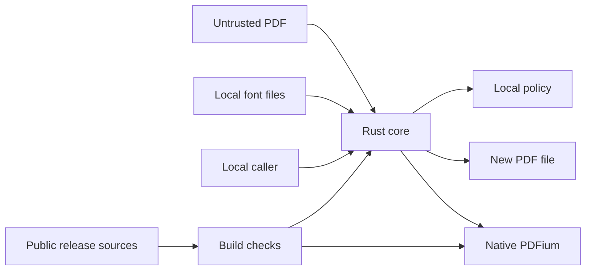

## Executive summary

The main risks are native parsing of hostile PDFs, resource exhaustion, and loading
an untrusted native library. The core has no server, account, database or network
client. Exclusive output creation protects originals; transactional edits and
independent text verification protect document integrity. The native parser remains
in-process: a PDFium vulnerability can exceed the protection of Rust validation.
This is a scoped design/code review, not a claim that arbitrary PDFs are safe.

## Scope and assumptions

Scope: core/, Cargo.toml, Cargo.lock, deny.toml, scripts/ and the fixture harness.
The Part B UI, release packaging, OS security, and hypothetical services are excluded.
Assumptions: local single-user Windows x64; documents may contain confidential data;
PDFs can originate from an attacker; DLL installation and system font directories
are locally trusted. No private accounts or external production targets were accessed.
Native parsing is not sandboxed. A future server/multi-user deployment or automatic
processing of untrusted files would materially change the risk ranking and require
process isolation and stronger resource quotas. No unresolved deployment assumption
blocks this local-library assessment.

## System model

### Primary components

- Engine runtime and editable byte snapshots: core/lib.rs, Engine and Document.
- Structured content and font-resource edits: core/content.rs, edit and runs.
- Font metadata, coverage and embedding: core/fonts.rs, embedded_font/find/embed.
- Local policy persistence: core/settings.rs, Substitution.
- Developer supply chain: Cargo.lock, deny.toml, scripts/setup-pdfium.ps1.
- Headless validation: core/tests.rs and tests/fixtures; isolated export source is
  tests/sources/libreoffice.fodt. There is no app entry point in Part A.

### Data flows and trust boundaries

- External PDF → Engine::open via filesystem bytes: 64 MiB read limit, bounded
  lopdf decompression, encryption rejection, native parser validation. OS file
  permissions apply; there is no network authentication boundary.
- PDF/font data → Rust parsers and native PDFium via memory/FFI: font and content
  stream limits, glyph validation, mapping checks and fallible APIs. Native memory
  safety and CPU/memory containment remain external assumptions.
- Caller text/selection → Engine::edit via typed API: length/control-character
  checks, revision checks, independent native round trip, and transactional commit.
- Engine → output filesystem via Document::save_as: regular PDF filename, original
  path check, create_new and sync_all. An I/O failure may leave a partial new output.
- Policy ↔ APPDATA filesystem via Substitution::load/save: 64-byte allowlist format,
  exclusive temporary creation and rename; no credentials or PDF contents stored.
- Official releases/crates.io → developer build via HTTPS: exact crate pins,
  Cargo integrity checks, source/license/advisory audit, release-age verification,
  and PDFium archive SHA256 before extraction. Runtime opens perform no downloads.

#### Diagram

## Assets and security objectives

| Asset | Why it matters | Security objective |
| --- | --- | --- |
| Source PDFs | Irreplaceable or confidential content | C/I |
| Saved document layout/text | Silent corruption can alter meaning | I |
| Local account and filesystem | Native code executes with local-user privileges | C/I |
| Memory and CPU | Hostile documents can exhaust application resources | A |
| DLL and dependency graph | Build inputs become executable code | I |
| Substitution setting | Determines scope of font changes | I |

## Attacker model

### Capabilities

An attacker can supply PDF syntax, streams, embedded fonts and metadata. They can
craft oversized or pathological documents. A compromised upstream release could
affect dependencies. A local attacker with write access to the installation can
replace a DLL; this requires substantially greater access than merely supplying a PDF.

### Non-capabilities

A PDF does not choose the DLL path, save destination, system-font roots or config
path. There is no remote request handler or ambient authenticated browser session.
Cross-tenant attacks, CSRF, CORS, SQL injection and account takeover through web
endpoints are not present in this scope. Local administrator compromise is excluded.

## Entry points and attack surfaces

| Surface | How reached | Trust boundary | Notes | Evidence |
| --- | --- | --- | --- | --- |
| PDF open/render | Caller supplies path/page/scale | External bytes → parsers | Native parser is in-process | core/lib.rs: Engine::open/render, parse |
| Font processing | Embedded streams or known local directories | Font bytes → parsers | Bounded reads; glyph and permission checks | core/fonts.rs: embedded_font/find/embed |
| Text edits | Caller supplies selection and text | Input → document integrity | Mapping and revision verification | core/lib.rs: Engine::edit; core/content.rs: verify_mapping |
| Save As | Caller supplies destination | Memory → filesystem | Exclusive creation, no overwriting | core/lib.rs: Document::save_as |
| Settings | APPDATA path or explicit local path | File bytes → policy | Tiny allowlisted representation | core/settings.rs |
| DLL acquisition/load | Setup script and Engine::new | Build/install → executable code | Exact release/checksum, absolute load path | scripts/setup-pdfium.ps1; core/lib.rs: Engine::new |
| Dependencies/fixtures | Cargo and explicit regeneration tools | Public packages → developer execution | Lockfile/audit/age; pinned fixture wheel | deny.toml; scripts/check-crate-age.py; scripts/subset-fixture.py |

## Top abuse paths

1. Malicious PDF → native decoder flaw → execution in the editor process → access
   to the local account. Size validation cannot eliminate this class.
2. Small compressed or pathological document → expensive decoding/rendering →
   application memory or CPU exhaustion despite raster and stream limits.
3. Crafted encoding or adjacent text state → incorrect font/cursor rewrite →
   silent text/layout corruption; transactional and pixel checks address this path.
4. Output alias or original path reuse → original overwritten → data loss;
   exclusive creation and explicit original-path protection reject this path.
5. Replaced DLL or compromised dependency → developer/runtime executes malicious
   code; absolute paths, checksums, pins and advisory checks narrow this boundary.
6. Malformed local policy → unintended document-wide changes; strict parsing fails
   instead of inventing a policy. A same-user attacker can otherwise alter local files.

## Threat model table

| Threat ID | Threat source | Prerequisites | Threat action | Impact | Impacted assets | Existing controls (evidence) | Gaps | Recommended mitigations | Detection ideas | Likelihood | Impact severity | Priority |
| --- | --- | --- | --- | --- | --- | --- | --- | --- | --- | --- | --- | --- |
| TM-001 | Malicious PDF | Exploitable PDFium defect and file opened | Trigger native parser memory corruption | Local-account execution/data theft | Documents/account | Non-V8 pinned DLL; Engine::new trusted path | No process sandbox | Maintain PDFium promptly; isolate parser before automated/unattended intake | Crash telemetry without document contents, local crash reproduction | medium: attacker controls complex parser input | high: native code has user privileges | high |
| TM-002 | Malicious PDF/font | Pathological valid or malformed input | Exhaust native decode resources | App unavailability | CPU/memory | MAX_FILE/MAX_STREAM/render/history limits | No hard native memory or time quota | Add worker-process quotas for unattended or large-scale processing | Measure job time/memory, log only generic failure category | medium: cheap input can cause expensive work | medium: local availability loss | medium |
| TM-003 | Crafted content/encoding | Selected run crosses unusual PDF state | Cause incorrect rewrite | Wrong text or neighboring layout | Output integrity | verify_mapping, glyph coverage, measured cursor repair, round-trip and render-diff tests | Unsupported nested/ambiguous mappings rejected; finite corpus | Expand exported corpus and regression cases as formats are supported | Test every new encoding and exported source against independent rendering | low: failure is transactional and mappings checked | high: silent corruption could affect meaningful text | medium |
| TM-004 | Destination alias/error | Caller chooses original/existing output | Overwrite original or leave incomplete new file | Data loss/confusing output | Source/output PDFs | create_new, original-path check, .pdf validation; safety tests | Failed writes may leave partial new file | Keep originals immutable; UI must display write failure and not announce success | Explicit save Result handling | low: existing outputs cannot be opened for writing | medium: partial new output; source protected | low |
| TM-005 | Supply chain/local DLL writer | Upstream compromise or write access to install | Substitute executable library/package | Local-code execution | Build/runtime integrity | Exact pins, SHA256, Cargo.lock, deny.toml, age script | Hash from release channel is not independent signing; install path must be protected | Preserve protected install directory, review updates and artifact provenance | Audit failures, checksum mismatches | low: additional upstream/local compromise required | high: code executes with user rights | medium |
| TM-006 | Local policy writer | Same-user config access | Switch substitution scope | Unintended broader edit | Document integrity | Strict allowlist and atomic save, undo transaction | Caller must load/display actual setting | Expose policy clearly in Part B; treat invalid settings as an error | Config parse error | low: requires local access | low: edits remain undoable and originals unchanged | low |

## Criticality calibration

- Critical: demonstrated PDF-triggered code execution without additional local
  access; demonstrated automatic exfiltration of opened documents. None demonstrated.
- High: credible native parser compromise; silent overwrite of originals through
  an ordinary Save As call. The latter is blocked by implemented controls.
- Medium: persistent process resource exhaustion; undetected layout/text corruption
  in an otherwise supported edit; compromised dependency provenance.
- Low: rejected malformed settings; a partial newly created output after disk
  failure; unsupported encoding reported without modifying the document.

## Focus paths for security review

| Path | Why it matters | Related Threat IDs |
| --- | --- | --- |
| core/lib.rs | Native loading, limits, transaction boundary, save protection | TM-001/002/004 |
| core/content.rs | Font resource ownership, encoding and cursor integrity | TM-003 |
| core/fonts.rs | Untrusted font parsing, collection offsets, embedding permissions | TM-001/002/003 |
| core/settings.rs | Strict policy persistence | TM-006 |
| scripts/setup-pdfium.ps1 | Binary integrity before extraction | TM-005 |
| Cargo.lock and deny.toml | Exact dependency graph and audit policy | TM-005 |
| core/tests.rs and tests/fixtures | Independent rendering and negative coverage | TM-002/003/004 |

## Notes on use

Review covered discovered runtime entry points and all listed boundaries, with
build tooling and fixtures separated from runtime. Assumptions match local desktop
use. Rust catches unwindable parser failures, but cannot catch native access
violations or OS out-of-memory termination. No web endpoint scanning was applicable.
No independent audit, fuzz campaign or native sandbox verification is claimed.
